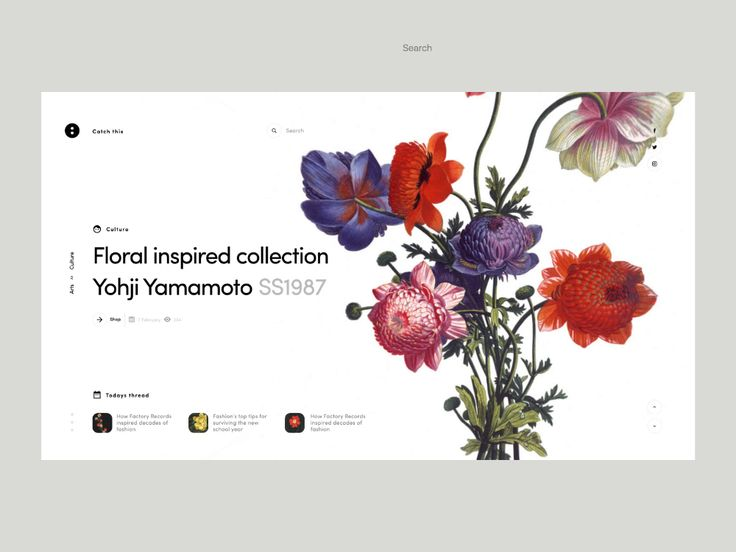
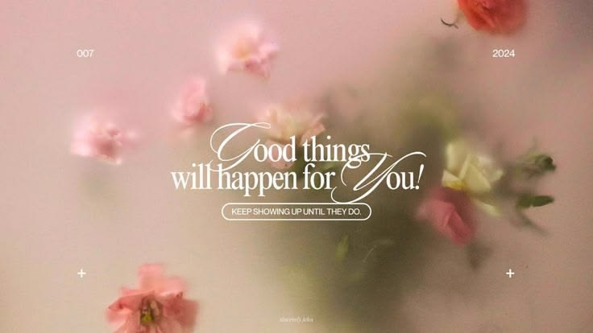
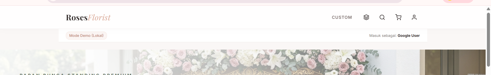
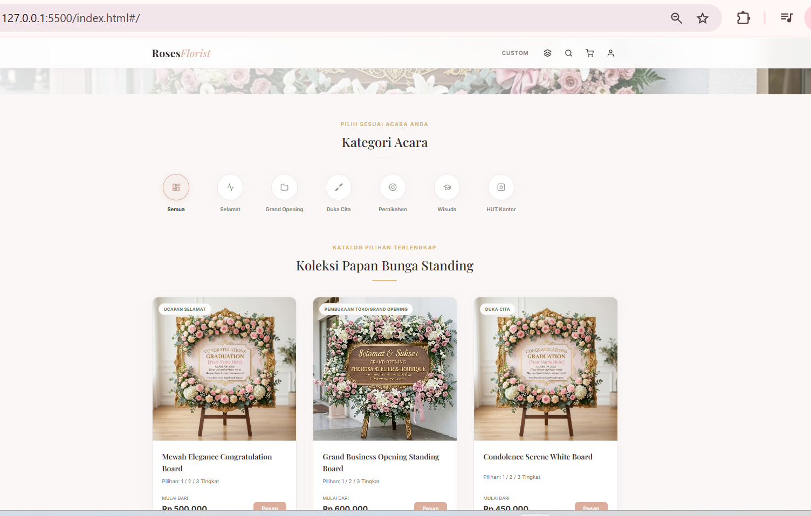
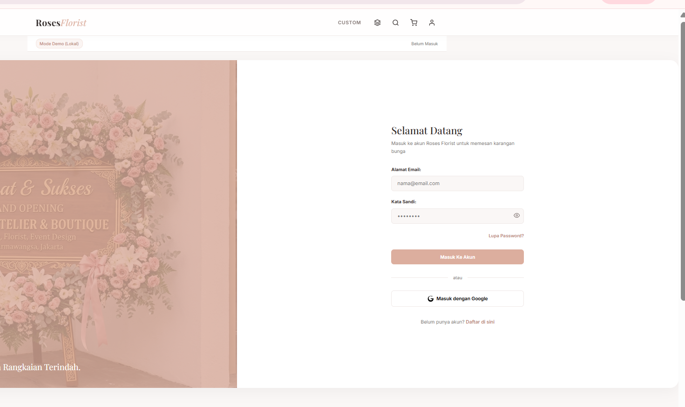
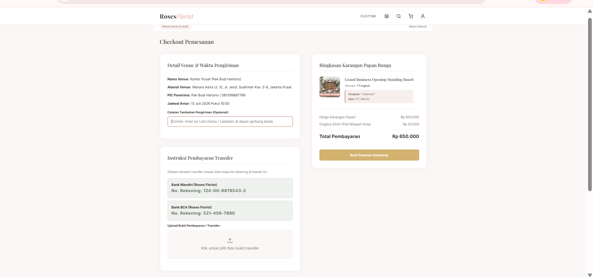
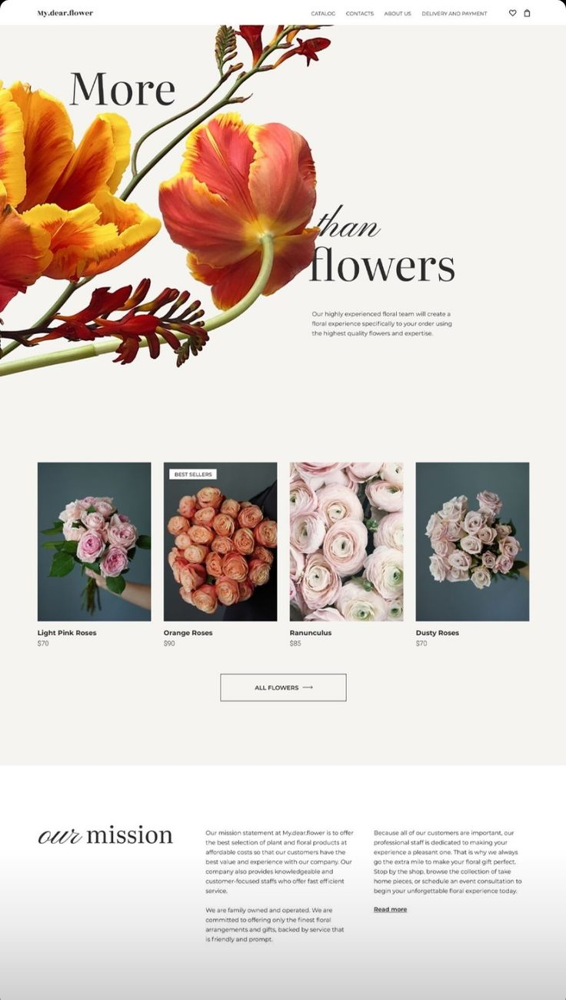
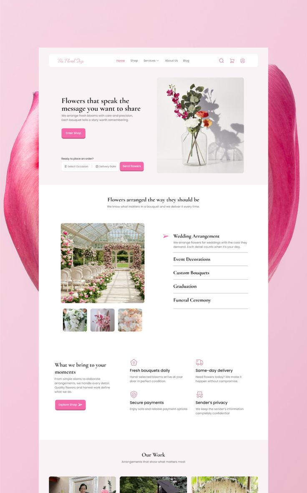
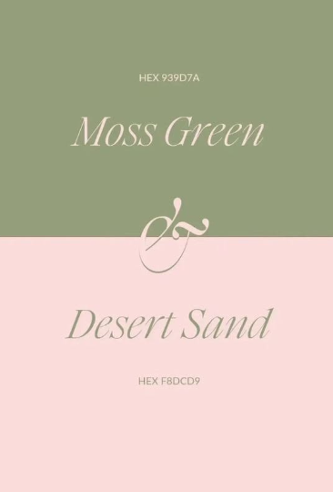

Beberapa yang perlu perbaikan 
1.	Menambahkan chat dengan pihak admin 
Desain halaman Inbox Chat untuk admin aplikasi karangan bunga "Roses Florist". Layout 2 kolom.

KOLOM KIRI (daftar percakapan, lebar sekitar 320px): search bar di atas untuk cari nama 
pengunjung. Di bawahnya list percakapan berbentuk card memanjang, masing-masing berisi: avatar 
bulat berisi inisial nama, nama pengunjung, waktu pesan terakhir, cuplikan 1 baris pesan terakhir 
(dipotong dengan elipsis), dan titik merah kecil di kanan kalau ada pesan belum dibaca. Card yang 
sedang aktif/dipilih diberi background pink dusty rose lembut dengan border kiri tebal warna pink 
tua. Card lain saat di-hover juga berubah warna lembut.

KOLOM KANAN (chat aktif, mengisi sisa lebar layar): 
- Header berisi avatar + nama pengunjung yang sedang dibuka
- Area percakapan di tengah: bubble chat pengunjung rata kiri warna hijau sage muda, bubble 
  balasan admin rata kanan warna pink dusty rose, masing-masing dengan jam kecil di bawahnya
- Kolom input di bagian bawah: textarea untuk mengetik balasan dan tombol kirim bulat warna pink 
  tua dengan ikon panah kirim

Kalau belum ada percakapan yang dipilih, kolom kanan menampilkan state kosong: ikon chat besar 
di tengah dan teks "Pilih percakapan di sebelah kiri untuk mulai membalas pesan pembeli."

Gaya visual keseluruhan: profesional tapi tetap hangat, warna dasar pink dusty rose dan hijau 
sage (bukan putih polos), rounded corner di semua card, sedikit shadow lembut. Di bagian paling 
atas halaman ada topbar sederhana: logo "Roses Florist" dan link "Kembali ke Dashboard".

Catatan penting: percakapan ini TANPA sistem login untuk pengunjung, jadi tidak ada foto profil 
asli — cukup avatar berupa inisial nama dalam lingkaran berwarna.

Tapi bisa menyesuaikan lagi yaa-sebagus mu
 
2.	Referensi untuk halaman paling awal sendiri 

3.	pada header mu kan ada bagian search kan?tapi itu untuk nge search apa kan kaya ga ngaruh kemana mana,sama bagian custom aja itu ngapain kok ada disitu

4.	Ini kan kita gapake haader yang biasanya yang Cuma navbar kalau di pencet langsung masuk ke section nya gitu nah apakah tidak lebih baiknya kita ada bagian katalog?

 

Iya benar di halaman tampilan awal ada bagian ini tapi menuru ku agak aneh aja katalog utama nya langsung di halaman awal gitu 
5.	Kemudian di halaman utama situ aku pengen nya ada daftar pertanyaan FAQ gitu beberapa aja gausa banyak banyak buat menurun kebawah gitu paham kan ?

6.	lalu untuk bagian pendaftaran ini logo google nya pakai logo google asli yaa

7.	dan bagian in tampilan nya di perbaiki lagi supaya lebih user friendly;berlaku untuk semua tampilan ui coba di perbaiki biar lebih friendly

8.	Referensi ui 
  

Color pellate utama ku 

info tentang toko nya 
ig : https://www.instagram.com/rosesflorist.pandaan/
https://www.instagram.com/karanganbunga_batu_pasuruan/
Alamat: Jl. Pahlawan Sunaryo, Pesantren, Pandaan, Kec. Pandaan, Pasuruan, Jawa Timur 67156
Wa : 0856784567

Logo :
 

